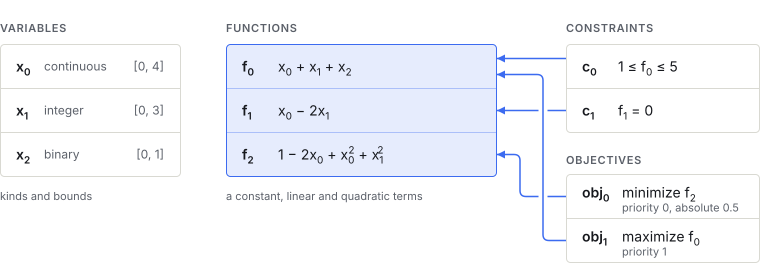

# Building a model {#sec-model}

A model holds the data of one problem: its variables, the functions of those variables, the constraints that bound functions and the objectives to optimize. This chapter builds one small model in C, step by step, then the same model in Python. The C code is `examples/c/model.c`, the Python code `examples/python/model.py`.

## Variables, functions and the records that use them {#sec-model-parts}

A model keeps its functions in one table. A function is a constant plus linear and quadratic terms in the variables. Constraints and objectives do not hold functions of their own: each refers to a function of the table by its index, so one function can serve several of them.

{#fig-families}

The model of @fig-families has three variables of different kinds and three functions. It bounds $f_0$ between 1 and 5 and holds $f_1$ at zero. It minimizes $f_2$ first and then maximizes $f_0$, letting $f_2$ rise by at most 0.5 above its optimum while it does:

$$
\begin{aligned}
\text{minimize}\quad & f_2(x) = 1 - 2x_0 + x_0^2 + x_1^2 \\
\text{then maximize}\quad & f_0(x) = x_0 + x_1 + x_2 \\
\text{subject to}\quad & 1 \le f_0(x) \le 5, \\
& f_1(x) = x_0 - 2x_1 = 0, \\
& x_0 \in [0, 4], \quad x_1 \in \{0, 1, 2, 3\}, \quad x_2 \in \{0, 1\}
\end{aligned}
$$

Items of each family are numbered from 0 in the order they are added, each family on its own: variable 0, function 0, constraint 0 and objective 0 are four different things. Every count and index is a `BIYOS_index`, a 32-bit integer, and an offset into the terms or a total of terms is a `BIYOS_offset`, a 64-bit integer, since a large model can hold more than $2^{31}$ terms. Kinds, senses and priorities are `BIYOS_int`, and bounds, constants and coefficients `BIYOS_real`, which is `double`.

## An environment and a model {#sec-model-handles}

A model is made on an environment, which holds the options and the event stream (@sec-events) and keeps the last error of each thread (@sec-errors). A call on the model reports there. The environment cannot be freed while a model made on it is not, so free the models first.

```{.c file="examples/c/model.c" item="main"}
```

Each step of `build` adds one family. The calls take many items at once: a count, then arrays of that many entries, which biyos reads during the call and does not keep. A call that fails changes nothing.

## Variables {#sec-model-variables}

Each variable has a kind and a lower and an upper bound. The kind says which values it may take:

| Kind | Takes |
| --- | --- |
| `BIYOS_VAR_CONT` | any value between its bounds |
| `BIYOS_VAR_BIN` | 0 or 1, between its bounds |
| `BIYOS_VAR_INT` | any integer between its bounds |
| `BIYOS_VAR_SEMICONT` | 0, or any value between its bounds |
| `BIYOS_VAR_SEMIINT` | 0, or any integer between its bounds |

Every kind but continuous is discrete. `BIYOS_addvar` adds variables after the last one:

```{.c file="examples/c/model.c" item="variables"}
```

A bound may be `INFINITY` or `-INFINITY` from `<math.h>`, which leaves that side unbounded. No finite bound is read as infinite, however large. A lower bound of `INFINITY`, an upper bound of `-INFINITY` and NaN are refused, and so is a bound outside the widest bounds of the kind: 0 and 1 for a binary variable, infinite for every other kind. Any other pair is kept as given, a lower bound above the upper one included.

A null `knd` makes every new variable continuous, and a null `lb` or `ub` gives each the widest bound of its kind. The last argument, here `NULL`, can receive the index of the first new variable, which is the number of variables held before the call; the new variables follow it in order. Every call that adds items ends with this argument.

`BIYOS_setvarbndsp` and `BIYOS_setvarkndsp` change variables already added. They take a list of indices, in which a variable may appear more than once: its entries apply in order and the last one wins. Every call that acts on items already added has such a list form, ending in `sp`, and a range form, ending in `rg`, which takes the first index `pos` and the count `n` in place of the list: `BIYOS_setvarbndrg(mdl, pos, n, lb, ub)` does what `BIYOS_setvarbndsp` does for the indices `pos` to `pos + n - 1`. A range that starts or ends past the last item is refused, even when it is empty. A variable that becomes binary must already have bounds inside $[0, 1]$, so set such bounds first. `BIYOS_getvarbndsp` and `BIYOS_getvarkndsp` read them back ([Reading a model back](#sec-model-reading)).

## Functions {#sec-model-functions}

A function of the variables $x$ is

$$
f(x) = c + \sum_j a_j x_j + \sum_{i \le j} q_{ij}\, x_i x_j ,
$$

a constant $c$, linear terms $a_j x_j$ and quadratic terms $q_{ij} x_i x_j$. `BIYOS_addfun` adds functions with the constant 0 and no terms, and later calls give them their constants and terms. `BIYOS_setcstrg` sets the constants of a range of functions, and `BIYOS_addrlintermrg` adds their linear terms. The terms of many functions travel in compressed form, as three arrays: function `pos + k` owns the terms from `off[k]` to `off[k + 1] - 1` of `varidx` and `coef`, which hold the index of a variable and its coefficient. So `off` holds one more entry than there are functions, begins at 0 and never decreases, and its last entry is the number of terms.

```{.c file="examples/c/model.c" item="functions"}
```

Here `off` is `{0, 3, 5, 6}`: function 0 owns terms 0 to 2, $x_0 + x_1 + x_2$; function 1 owns terms 3 and 4, $x_0 - 2x_1$; function 2 owns term 5, $-2x_0$, and its constant 1.

The terms of a function may come in any order, and biyos keeps them sorted by variable. Each must name a variable of the model, appear once in its function and have a finite coefficient. A term whose coefficient is 0 is kept, so a model reads back as it was given.

`BIYOS_setcstsp` sets the constants of a list of functions, and `BIYOS_addcstsp` adds to them: a function listed twice in one call gains both entries, in order. Each constant stays finite, and a sum that would leave the finite range refuses the call, which then changes nothing. `BIYOS_getcstsp` reads the constants back, and each of the three has its range form, ending in `rg`.

A variable the function already holds adds its coefficient to the one held, so a function can be built in several calls. `BIYOS_addlintermsp` takes terms as coordinates, the function, the variable and the coefficient of each, in any order. `BIYOS_addclintermrg` takes the terms of a range of variables, each variable with the functions it enters, so a variable added late joins the functions of existing constraints in one call. Every adder follows the same rules, and a refused call changes nothing. `BIYOS_getrlintermsp` reads the linear terms of a list of functions as coordinates, the function, the variable and the coefficient of each term, and `BIYOS_getrlintermrg` those of a range in compressed form. `BIYOS_getclintermsp` and `BIYOS_getclintermrg` read them the other way round: for each variable, the functions that hold it, sorted by function, with their coefficients ([Reading a model back](#sec-model-reading)).

## Quadratic terms {#sec-model-quadratic}

Functions are added with no quadratic terms. `BIYOS_addquadtermsp` adds them as coordinates, the function, the two variables and the coefficient of each, in any order:

```{.c file="examples/c/model.c" item="squares"}
```

A coefficient is taken as written, with no factor $\tfrac12$: $x_0^2$ is the pair $(0, 0)$ with the coefficient 1, and $x_0 x_1$ the pair $(0, 1)$ with the coefficient 1. A pair may be given in either order and is kept as $(i, j)$ with $i \le j$. A pair the function already holds adds its coefficient to the one held, so every call adds $q_{ij} x_i x_j$ to its functions and never replaces a term. `BIYOS_addquadtermrg` takes the terms of a range of functions in compressed form, with two arrays for the two variables of each pair, and follows the same rules. A refused call changes nothing. `BIYOS_getquadtermsp` reads the quadratic terms of a list of functions as coordinates, the function, the two variables and the coefficient of each term, and `BIYOS_getquadtermrg` those of a range in compressed form.

A call that adds new pairs moves the terms of every function from the lowest one it touches, so add the quadratic terms of many functions in one call, or those of a function right after the function itself.

## Constraints {#sec-model-constraints}

A constraint $l \le f(x) \le u$ bounds one function of the table. `BIYOS_addcon` takes the index of each constraint's function and its two bounds:

```{.c file="examples/c/model.c" item="constraints"}
```

Constraint 1 has equal bounds, which makes it the equality $f_1(x) = 0$. A constraint whose bounds are both infinite is free. The bounds follow the rule of a continuous variable's: an infinite bound leaves its side open, and a lower bound of `INFINITY`, an upper bound of `-INFINITY` and NaN are refused. A null `lb` or `ub` leaves that side of every new constraint unbounded. `BIYOS_setconbndsp` changes the bounds and keeps the function, and `BIYOS_getconbndsp` reads the bounds of a list of constraints.

## Objectives {#sec-model-objectives}

An objective names a function to minimize or maximize, with a priority, a weight and two tolerances. `BIYOS_addobj` takes what defines it, the function, sense, priority and weight, as `BIYOS_addcon` takes a function and its bounds. Its tolerances are 0 until `BIYOS_setobjtolsp` sets them, as here for objective 0:

```{.c file="examples/c/model.c" item="objectives"}
```

The objectives are optimized in stages, one for each priority they hold, the lowest first. A stage minimizes the weighted sum of the objectives of its priority,

$$
\sum_{i \in P} w_i\, s_i\, f_i(x), \qquad s_i = \begin{cases} 1 & \text{to minimize} \\ -1 & \text{to maximize,} \end{cases}
$$

where $P$ holds the objectives of that priority and $w_i$ is the weight of objective $i$. Each later stage keeps every objective of an earlier stage within its tolerances of the optimum found for it: the absolute tolerance in the units of its function, the relative one as a fraction of the size of that optimum. Objectives of different priorities are therefore optimized in sequence, and objectives of one priority are blended.

A weight is finite and positive, so the sense alone gives the direction. A tolerance is 0 or more, and `INFINITY` sets no limit. A null `sense` minimizes every new objective, a null `coef` gives each the weight 1, and a null `prio` gives each objective its own index as its priority. So by default the objectives are optimized one after another in the order they are added, which is what this model asks for explicitly.

`BIYOS_setobjsensesp`, `BIYOS_setobjpriosp`, `BIYOS_setobjcoefsp` and `BIYOS_setobjtolsp` change one attribute of a list of objectives each, and `BIYOS_getobjsensesp`, `BIYOS_getobjpriosp`, `BIYOS_getobjcoefsp` and `BIYOS_getobjtolsp` read it back with the same arguments. `BIYOS_getobjrg` reads back what `BIYOS_addobj` takes, so a model is read whole with it and `BIYOS_getobjtolsp`.

::: {.callout-note}
## Stored, not yet solved
biyos stores and checks the objectives but solves nothing yet. The stages above are what the model means, and what the solvers will do with it.
:::

## Reading a model back {#sec-model-reading}

Every family has a count and a reader: `BIYOS_getnvar` and `BIYOS_getvarrg`, `BIYOS_getncon` and `BIYOS_getconrg`, and so on. Functions have a count, `BIYOS_getnfun`, and are read through their constants and terms. A reader never changes the model, and its error, if any, goes to the environment like every other call's. A reader takes the items to read and fills the arrays it is given; a null array is skipped. Since the caller cannot know the number of terms in advance, each reader of terms has a count reader: `BIYOS_getnquadtermrg` gives the number of terms `BIYOS_getquadtermrg` writes for the same range, `BIYOS_getnrlintermsp` the number `BIYOS_getrlintermsp` writes for the same list, and so on. A reader of terms refuses arrays that hold fewer and then writes nothing, so a caller counts, allocates, and reads:

```{.c file="examples/c/model.c" item="read_squares"}
```

A family reader reads a list or a range: `BIYOS_getvarsp` reads the variables a list names, in its order and as often as it names them, and `BIYOS_getvarrg` a range of them. Every setter of an attribute has a reader that takes the same arguments, its outputs where the setter's inputs are, so the attribute of any list of items, such as `{0, 4, 10, 12}`, is read in one call: `BIYOS_getvarbndsp` reads what `BIYOS_setvarbndsp` sets, and `BIYOS_getvarbndrg` what `BIYOS_setvarbndrg` sets. An item may appear in the list more than once, and a null output is skipped.

## Names {#sec-model-names}

The model and each variable, function, constraint and objective may have a name, which a message or a file can show in place of an index. A name is not empty, is well-formed UTF-8 and holds no NUL character. A C string ends at its first NUL, so a name passed in C never holds one, and Python refuses a `str` that holds one with `ValueError`.

Names match byte for byte, so two names that differ only in case or in Unicode normalization are different names. An item has no name until one is set, and while it has none it reads as an empty string in C and as `None` in Python. A copy of the model holds the same names.

`BIYOS_setmdlname`, `BIYOS_getmdlname` and `BIYOS_delmdlname` set, read and remove the name of the model. Each family takes four calls, named after its short form, `var`, `fun`, `con` or `obj`: `BIYOS_setvarnamesp` names a list of variables, `BIYOS_getvarnamesp` reads the names of a list, `BIYOS_getvaridx` looks up a list of names, and `BIYOS_delvarnamesp` leaves the variables of a list without a name. The setter and the reader take the same arguments, so any list of items is named or read in one call. Each of `BIYOS_setvarnamesp`, `BIYOS_getvarnamesp` and `BIYOS_delvarnamesp` has its range form, ending in `rg`. As in the other setters, an item listed more than once takes its last entry.

Names may repeat. Setting a name checks no uniqueness, so several items of a family may hold the same name, while each family keeps its names apart from the others. A lookup never chooses among the holders of a name: `BIYOS_getvaridx` gives the index of the variable that alone holds a name, and refuses a name that no variable holds or that several hold, counting them, as in `invalid argument: variable 'x': names 3 variables`. So a lookup never returns an item the caller did not mean, and it succeeds again once the other holders are renamed or lose their names.

A name read in C belongs to the model. The pointer stays valid until a call that sets or removes the name of that item succeeds, or the model is freed; adding items, naming other items, a call that fails and a copy of the model leave it valid.

## The same model in Python {#sec-model-python}

The Python package wraps the same calls under the same names, without the prefix. Each method that adds variables, functions, constraints or objectives returns a block, a light object holding the first index and the count of the new items, and indexing a block gives a view of one item. A block or a view passes wherever the model takes indices, so the code reads as the mathematics does:

```{.python file="examples/python/model.py" item="build"}
```

A block costs the same at any size, and the model refuses a block or a view of another model. @sec-python describes the package as a whole.
