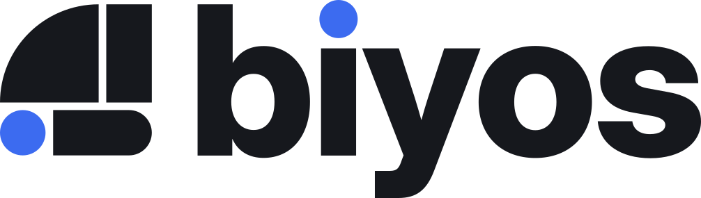

# Overview {.unnumbered}

::: {.content-visible when-format="html"}
::: {.hero}
{.hero-logo .light-content fig-alt="biyos"}
{.hero-logo .dark-content fig-alt="biyos"}

[An optimization solver,\
built from parts.]{.display}

[biyos is being built for nonlinear, conic and mixed-integer optimization. **One C API** states the model, each method is **assembled from interchangeable parts** chosen at run time, and every result says **what was proved**: a global optimum, a local one, or nothing.]{.lead}
:::
:::

::: {.content-visible unless-format="html"}
biyos is being built for nonlinear, conic and mixed-integer optimization. One C API states the model, each method is assembled from interchangeable parts chosen at run time, and every result says what was proved: a global optimum, a local one, or nothing.
:::

It is designed for problems of the form

::: {.form}
$$
\begin{aligned}
\text{minimize}\quad & f_1(x),\ \dots,\ f_p(x) \\
& \text{in priority order} \\
\text{subject to}\quad & l \le g(x) \le u \\
& h(x) \in K \\
& x_j \in \mathbb{Z} \quad \text{for } j \in J
\end{aligned}
$$
:::

where the bounds $l$ and $u$ may be infinite, $K$ is a product of cones and $J$ is the set of integer variables. The chapter [The problem form](#sec-form) states it in full.

::: {.content-visible when-format="html"}
::: {.cards}
::: {}
[Part I]{.label}

[User guide](guide/start.qmd)

Build the library, state a model in C or Python, set options, read events and handle errors.
:::

::: {}
[Part II]{.label}

[Method](method/form.qmd)

The mathematics: the problem form, the expression graph, tapes, derivatives, intervals and curvature.
:::

::: {}
[Part III]{.label}

[Reference](reference/capi.qmd)

Every function, type and constant of the C API, every option, every code and event, and the Python API.
:::
:::
:::

## Where biyos stands {.unnumbered}

biyos is at its start. It holds a model and checks every part of it, and inside it evaluates expressions, their derivatives and their ranges. It solves nothing yet.

- A model holds variables of five kinds, functions made of a constant and linear and quadratic terms, constraints that bound functions, and objectives in priority order. It is built, read back and copied through the C API and the Python package ([Building a model](#sec-model)).
- Options are typed, checked when set and versioned, so a caller learns when an option appeared and when it stops working ([Options](#sec-options)).
- One stream of events carries messages, failed checks and timings. The library never prints; a hook decides what to do with each event ([Events and timing](#sec-events)).
- Inside, an expression graph of 29 operators ([The expression graph](#sec-graph)) is compiled into tapes ([Compiled tapes](#sec-tapes)) that evaluate values and gradients ([Derivatives](#sec-derivatives)), and evaluated over boxes with outward rounding ([Intervals](#sec-intervals)).

## Reading this book {.unnumbered}

The User guide walks through the tasks of a program that uses biyos, in C and in Python. Each piece of code it shows is part of a program under `examples/` that the build runs as a test, so what the guide shows works. The Method part states the mathematics with no reference to the code, for readers who want to know what biyos computes and what it proves. The Reference part is generated from the header, a specification of the C API and the option table, so it holds every public name and stays in step with the code.

Every public C name starts with `BIYOS_`: functions and types in lowercase, such as `BIYOS_addvar` and `BIYOS_env`, and constants in uppercase, with their group, such as `BIYOS_ERR_NOMEMORY`. Python uses the same words without the prefix, such as `model.addvars`, so one name serves both languages and this book.
