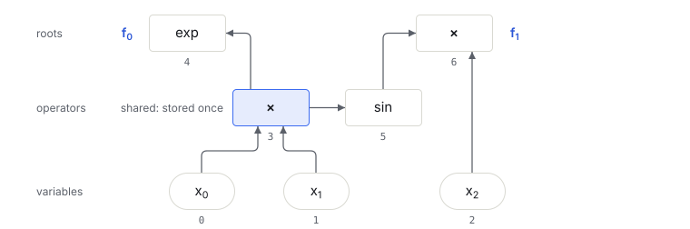

# The expression graph {#sec-graph}

The expression $e$ of a function, the part of its nonlinear part $\varphi$ that biyos can read (@eq-nonlinear), is a node of the model's expression graph; callbacks supply the rest. This chapter defines the graph, its 29 operators and their domains, and the way an expression is split into the parts of a function.

## Nodes and sharing {#sec-graph-nodes}

The graph of a model is a directed acyclic graph. Each node applies an operator to its children: a leaf is a constant or a variable, and every other node is a function of the values of its children. A node used by several parents, or by several functions, is stored once, so its value is computed once wherever it appears.

{#fig-graph}

Nodes are numbered in the order they are added, and a node is added only after its children, so the ids form a topological order, as in @fig-graph. A computation from the leaves up, such as evaluation, visits the nodes by increasing id, and a computation from the roots down, such as differentiation in reverse, by decreasing id. No node holds anything that depends on a point or a solve: values, derivatives and intervals live in arrays indexed by node id, so many evaluations can run on one graph at once.

Sums and products take any number of children. A sum $c + \sum_i a_i e_i$ carries a constant and a coefficient for each child, and a product $c \prod_i e_i$ a coefficient. A sum of sums built in one expression is flattened into one sum, and a product of products into one product, unless the inner node is already stored for another use.

## The operators {#sec-graph-operators}

The graph has 29 operators. Each is defined by the value `<cmath>` gives, and its domain is the set of arguments where that value is a real number:

| Operator | Value | Domain |
| ------------ | ------------------------ | ------------------------ |
| constant | $c$ | everywhere |
| variable | $x_j$ | everywhere |
| sum | $c + \sum_i a_i e_i$ | everywhere |
| product | $c \prod_i e_i$ | everywhere |
| negation | $-e$ | everywhere |
| division | $e_1 / e_2$ | $e_2 \ne 0$ |
| power by a constant | $e^c$ | as for the power below, with $e_2 = c$ |
| power | $e_1^{e_2}$ | $e_1 > 0$; $e_1 = 0$ with $e_2 \ge 0$; $e_1 < 0$ with $e_2$ an integer |
| exponential | $\exp e$ | everywhere |
| logarithm | $\log e$ | $e > 0$ |
| square root | $\sqrt{e}$ | $e \ge 0$ |
| sine, cosine | $\sin e$, $\cos e$ | everywhere |
| tangent | $\tan e$ | $e \notin \tfrac{\pi}{2} + \pi\mathbb{Z}$ |
| absolute value | $\lvert e \rvert$ | everywhere |
| maximum, minimum | $\max_i e_i$, $\min_i e_i$ | everywhere |
| arc sine, arc cosine | $\arcsin e$, $\arccos e$ | $-1 \le e \le 1$ |
| arc tangent | $\arctan e$ | everywhere |
| hyperbolic sine, cosine, tangent | $\sinh e$, $\cosh e$, $\tanh e$ | everywhere |
| inverse hyperbolic sine | $\operatorname{arsinh} e$ | everywhere |
| inverse hyperbolic cosine | $\operatorname{arcosh} e$ | $e \ge 1$ |
| inverse hyperbolic tangent | $\operatorname{artanh} e$ | $-1 < e < 1$ |
| entropy | $e \log e$, with $0 \log 0 = 0$ | $e \ge 0$ |
| sign power | $\operatorname{sign}(e)\, \lvert e \rvert^c$, with $c > 0$ | everywhere |
| error function | $\operatorname{erf} e$ | everywhere |

Every constant, coefficient and exponent is finite. A pole lies outside the domain: $\log 0$, a division by zero, $0^{e_2}$ with $e_2 < 0$ and $\operatorname{artanh}(\pm 1)$ have no value. Outside its domain an operator gives the NaN or the infinity that `<cmath>` gives, and never stops the computation.

Entropy and sign power could be written with the other operators, as a product with a logarithm and as a product of a sign and a power. They are operators of their own because each, taken whole, is a simple function with a known shape: entropy is convex on its domain, and sign power is increasing and continuous since its exponent is positive. Split into pieces, that shape is lost, and the bounds and relaxations built from the pieces are much weaker.

## Splitting an expression {#sec-graph-split}

A function keeps its constant, linear and quadratic terms apart from the graph ([Functions](#sec-form-functions) in the problem form), so an expression is split when it enters a function. The split opens the sum at the top of the expression, pushes negations and constant factors into it, and moves out every term that is a constant, a variable times a constant, a product of two variables times a constant or the square of a variable. What remains forms $e$. The split does not expand: a power or a product of a sum stays a node of the graph, so $(x_0 + x_1)^2$ is not rewritten as three quadratic terms. A node that the expression shares with others is used whole, since splitting it would change what the others see.

For example, $3 - 2(x_0 - x_0 x_1) + \exp(x_2)$ becomes the constant 3, the linear term $-2x_0$, the quadratic term $2 x_0 x_1$, and $e = \exp(x_2)$.
