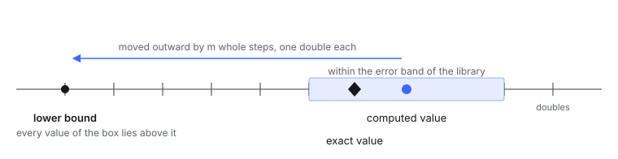

# Intervals and outward rounding {#sec-intervals}

A global method needs to know, for a box of variables, a range that holds every value a function can take there. biyos computes such ranges by evaluating the graph over intervals, one forward pass up the node ids, and rounds every bound outward so that floating point never shrinks a range below the truth. This chapter states what an enclosure holds, how each bound is rounded, and the one assumption the rounding makes about the mathematical library.

## Intervals and enclosures {#sec-intervals-enclosure}

An interval is a closed set of reals $[l, u]$ with $l \le u$, $l < +\infty$ and $u > -\infty$, or the empty set. An infinite bound is a limit, so $[-\infty, 0]$ is $(-\infty, 0]$. A box gives each variable an interval.

The domain of a node on a box is the set of points of the box where the node and every node below it are defined, in the sense of @sec-graph-operators. The enclosure of a node over a box is an interval that holds

1. every real value the node takes at a point of its domain on the box, and
2. every double the forward sweep computes there, sums and products rounded in the order of the graph.

Each operator maps the intervals of its children to an interval for itself, its natural interval extension [@moore2009], and the enclosures of all nodes come from one pass up the ids. Only the part of a box inside an operator's domain counts: $\log [-1, 4]$ is $[-\infty, \log 4]$, and $\log [-2, -1]$ is empty. A pole lies outside every domain, so $1/x$ over $[0, 1]$ is enclosed by $[1, +\infty]$ widened one step below 1. An empty child gives an empty node, and a factor that is exactly zero gives zero, so $0 \cdot [-\infty, +\infty] = [0, 0]$.

The second clause lets a method compare the enclosure with values it computes itself, and has two limits. A computed value can be NaN where the real value exists, and is then not enclosed: $\log(x - \sqrt{x}\sqrt{x} + 10^{-17})$ at $x = 2$ computes NaN although its real value is $\log 10^{-17}$, and $0 \cdot \exp 800$ computes NaN against the enclosure $[0, 0]$.

## Rounding outward {#sec-intervals-rounding}

The rounding mode is never changed. Instead each bound computed in round-to-nearest is moved outward by whole steps, a step being the distance to the next double in that direction, so $m$ steps move a bound past $m$ doubles. Moving through the ordered bit patterns of doubles does this in one operation for any $m$.

{#fig-rounding}

The number of steps depends on how the bound was computed:

- **One step** for $+$, $-$, $\times$, $\div$ and $\sqrt{\ }$. IEEE 754 rounds these correctly [@ieee754], so the exact value lies within one step of the computed one, and since rounding is monotone, so does the computed value at any point of the box. A zero operand of a sum or a product gives an exact result and is not moved. A result of $+0$ is kept as a lower bound and $-0$ as an upper bound, since a sum is zero only when it is exact, and a product or quotient that underflows to zero keeps the sign of its exact value.
- **$m = 256$ steps** for every bound computed by a function of the C library other than the square root: $\exp$, $\log$, the trigonometric and hyperbolic functions and their inverses, $\operatorname{erf}$, the power, and the product $x \log x$ of entropy.

Each result is then cut to the image of its function, itself rounded outward: $[0, +\infty]$ for $\exp$, $[1, +\infty]$ for $\cosh$, $[-1, 1]$ for $\sin$, $\cos$, $\tanh$ and $\operatorname{erf}$, $[-\pi/2, \pi/2]$ for $\arcsin$ and $\arctan$, $[0, \pi]$ for $\arccos$. Where a function has a root, the result is cut to its sign: at 0 for $\sinh$, $\tanh$, $\operatorname{arsinh}$, $\operatorname{artanh}$, $\arctan$, $\arcsin$, $\operatorname{erf}$ and sign power, at 1 for $\log$, $\operatorname{arcosh}$, $\arccos$ and entropy. So $\sinh [0, 1]$ starts at exactly 0 and $\log [0, 1]$ ends at exactly 0, which division and curvature need. Rounding a bound outward by 256 steps widens it by about $256 \cdot 2^{-52} \approx 5.7 \times 10^{-14}$ relative to its size, far below any feasibility tolerance.

## Why 256 steps {#sec-intervals-margin}

Suppose the library computes $f$ within $k$ units in the last place. Then its result $\tilde f$ satisfies $|\tilde f - f| \le r |f| + s$ with $r = k \cdot 2^{-52}$ and $s = k \cdot 2^{-1074}$, the second term covering subnormal results. Take $f$ monotone on a piece of the box, its least value at an end $e$, and $\tilde v = \tilde f(e)$. Since $z - r|z| - s$ grows with $z$, every value computed on the piece is at least

$$
\tilde v - 2.01\,\big(r |\tilde v| + s\big).
$$

One step down from $\tilde v$ is at least $\max\big(|\tilde v| \cdot 2^{-54},\ 2^{-1074}\big)$, so $m$ steps cover the loss once $m \ge 16.08\, k$. Entropy's bound comes from $x \log x$ with the logarithm within $k$ units, and its error has the same form with $k + 1$ in place of $k$. With $k = 14$ the margin must be at least $16.08 \cdot 15 = 241.2$ steps, and biyos takes 256. An upper bound is symmetric.

## What is proved and what is assumed {#sec-intervals-assumption}

The enclosure is proved given two assumptions about the machine:

- every function of the C library that biyos uses is within 14 units in the last place of the exact value, and
- the floating-point environment rounds to nearest and keeps subnormal numbers, with no flush to zero.

The first is an assumption, not a fact that biyos can check: IEEE 754 recommends correctly rounded functions but does not require them, and libraries do not provide them. The survey of Gladman et al. reports the largest errors its search finds in common libraries [@gladman2026]. In double precision those are lower bounds on the true largest errors, since no search can be exhaustive there. For the functions biyos uses, most of its entries stay well within 14 units, but there are exceptions: in double precision it reports an error of about $1.9 \times 10^{19}$ units for `sinh` in GNU libc 2.44, which no margin covers. The claim about computed doubles, the second clause of an enclosure, further needs each library result to stay inside the outward-rounded image of its function and to keep the sign of the exact value, which the survey does not measure.

The second assumption is a property of the thread that runs the computation. Options such as `-ffast-math` and some compilers turn flush to zero on, and under it the one-step rule fails near the subnormal numbers, where a result flushed to zero lies further than one step from the exact value.

## Arcs, powers and entropy {#sec-intervals-special}

A few operators are not monotone and need their extrema found:

- $\sin$ and $\cos$ over an arc narrower than $\pi$ take the values at its ends, plus 1 when it holds a peak or $-1$ when it holds a trough, found from the sign of the derivative at the ends. A wider arc is split once at its midpoint, so arcs below $2\pi$ stay tight, and anything wider or unbounded is $[-1, 1]$. A point box skips the test: its one value, widened by the margin and cut to $[-1, 1]$, is the enclosure.
- $\tan$ over an interval narrower than $\pi$ whose ends have cosines of one sign is $[\tan a, \tan b]$, and every other interval meets a pole and gives the whole line.
- $x^y$ is the hull of the corner values of the power on the part of the box with $x \ge 0$ and, for $x < 0$, of $\pm |x|^n$ over the integers $n$ in the exponent's range, with $+$ when an even one is there and $-$ when an odd one is. Sign power is increasing, so its ends give its enclosure.
- Entropy is convex with its least value $-1/e$ at $x = 1/e$.
