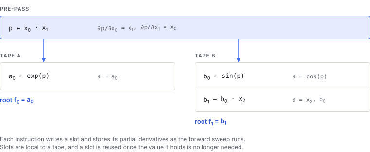

# Compiled tapes {#sec-tapes}

The graph describes the structure of the functions. Evaluating them many times at many points, as an interior point method does, runs instead on tapes compiled from the graph: flat lists of instructions in which every operand is a slot of a small workspace. This chapter describes how the graph becomes tapes and how a tape is run.

## Straight-line programs {#sec-tapes-programs}

Evaluating the roots of the graph at a point is a straight-line program, an evaluation procedure in the sense of algorithmic differentiation [@griewank2008]: a sequence of elementary steps

$$
v_k = \phi_k\big(v_{j} : j \in \mathcal{C}(k)\big), \qquad k = 1, \dots, N,
$$

where each $\phi_k$ is one of the [operators of the graph](#sec-graph-operators), each $\mathcal{C}(k)$ lists the steps it reads, all earlier than $k$, and the leaves read the variables $x$. The graph fixes such a program up to the order of independent steps, and a tape is one such program written down once, so that running it needs no walk of the graph, no recursion and no dispatch on node kinds beyond one switch per step.

## Partitions and pinned nodes {#sec-tapes-partitions}

The roots of a model are cut into partitions of consecutive roots, by a budget on the number of nodes each partition computes and the leaves it reads, sized so that a partition's values stay in the fastest cache of a core. Each partition compiles into its own tape. A node that the roots of several partitions reach is pinned: it is computed once, before the partitions run, by a pre-pass over the pinned nodes in increasing id, and each tape reads its value from the pinned slots.

{#fig-tapes}

Inside a tape the operands are slot indices local to the tape, and the workspace is sized when the tape is compiled. A slot is reused once the value it holds has been read for the last time, so a tape needs as many slots as values that are alive at once, not one per instruction. A tape is read-only once compiled, and a changed graph needs new tapes.

## The forward sweep {#sec-tapes-forward}

Running a tape is its forward sweep: the instructions in order, each writing its value into its slot. The sweep also stores, for each instruction, the partial derivatives of its value with respect to each of its operands, $\partial \phi_k / \partial v_j$ for $j \in \mathcal{C}(k)$, at the point. These are the local derivatives the reverse sweep of @sec-derivatives needs, and storing them once costs less than computing them again in every sweep that passes through a shared node, as `sin`, `cos` and the powers would require.

For a product the partials are the products of the other factors, computed as prefix and suffix products rather than by dividing the product by a factor, so a zero factor gives the right partials. The maximum and the minimum pass their derivative to the operand that gives the value.

Every instruction of a tape belongs to one or several roots, and each root's instructions form runs of consecutive instructions, located once when the tape is compiled. A sweep for one root visits only its runs and the pinned nodes it reaches.

## Why tapes {#sec-tapes-why}

The graph serves analysis: bounds, curvature and relaxations need its structure and its parents. Evaluation needs none of that, and gains from a flat list. A tape's operands are 32-bit indices into a workspace that stays in cache, the stored partials remove repeated work in the reverse sweep, and the plain loop over instructions is the shape that evaluating several points per sweep, and several partitions on several threads, will build on. Running an expression as instructions over a reused set of slots is also how CasADi's virtual machine works [@andersson2019].
